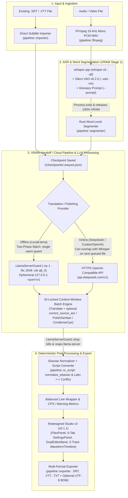

# EasySRT Studio — System Architecture & Technical Design

**EasySRT Studio** is an offline-first desktop application built on **Tauri v2**, **Rust**, **React 19**, **TypeScript**, and **Tailwind CSS v4**. It orchestrates local audio/video normalization, speech-to-text transcription, word-level subtitle segmentation, context-aware translation, Serbian Ekavian linguistic polishing, deterministic Serbian Cyrillic ↔ Latin script conversion, and multi-format subtitle import/export.

---

## 1. End-to-End Data Flow

EasySRT Studio supports two primary entry paths into its unified `SubtitleProject` data model:
1. **Media Pipeline (`.mp3`, `.wav`, `.m4a`, `.flac`, `.ogg`, `.aac`, `.mp4`, `.mkv`, `.webm`)**: Runs through FFmpeg normalization, Whisper ASR + Silero VAD, and the Rust word-level segmenter.
2. **Direct Subtitle Import (`.srt`, `.vtt`)**: Parses existing SubRip or WebVTT files (`pipeline::importer` / `parseSubtitleFileText`) directly into `SubtitleProject` cues for translation, Serbian polishing, script conversion, re-wrapping, Search & Replace (`Ctrl+H`), Undo/Redo (`Ctrl+Z`/`Ctrl+Y`), and multi-format export.



### Module Breakdown (`src-tauri/src/` & `src/components/`)

| Module | Responsibility |
| :--- | :--- |
| `models.rs` | Canonical `camelCase` data contract shared 1:1 with `src/types/models.ts` (including `JobOptions.correct_source_asr`). |
| `hardware.rs` | `nvidia-smi` GPU probing (`CREATE_NO_WINDOW` on Windows), multi-GPU max-VRAM selection, and `VramTier` classification (`CpuOnly`, `Vram4Gb`, `Vram8Gb`, `Vram12GbPlus`). |
| `storage.rs` | `Portable` (`portable.flag`) vs `Installed` path resolution, atomic `config.json` and checkpoint persistence (`<job_id>.easysrt.json`), and OS Keyring + portable credential fallback. |
| `setup_manager.rs` | Curated catalog loader (`resources/catalog.json`), resumable HTTP `Range` downloader (`.part` files), SHA-256 verification, ZIP/TAR.GZ extractor, and custom `.bin`/`.gguf` model management. |
| `pipeline/ffmpeg.rs` | Spawns `ffmpeg -y -i <input> -vn -acodec pcm_s16le -ar 16000 -ac 1 <temp.16k.wav>` with cancellation polling and WAV header duration calculation. |
| `pipeline/whisper.rs` | Runs `whisper-cli -ojf` with Silero VAD (`--vad -vm`), glossary hints (`--prompt`), physical-thread cap, `-bs 1 -bo 1 -nf -fa` decoding, plus `probe_whisper_binary_runnable()` pre-flight probe and automatic CPU binary fallback on missing shared libraries (`libvulkan.so.1` / CUDA DLLs). |
| `pipeline/segmenter.rs` | Groups `TimedWord`s into `SubtitleCue`s using punctuation, pause (`>= 350ms`), dangling-word penalty (`is_dangling_function_word`), duration, and character limits (`Standard` 2×42, `Reels` 1×20, `Custom`), balanced 2-line wrapping, and CPS metrics. |
| `pipeline/llama_server.rs` | RAII `LlamaServerGuard` binding an ephemeral localhost TCP port with 4 GB VRAM auto-fit (`-np 1 -fitc 2048 -fitt 128 -ctk q8_0 -ctv q8_0`), automatic `-ngl 0` CPU fallback, `/health` polling, and `Drop` process reaping. |
| `pipeline/translator.rs` | ID-locked sliding context-window batch translator (supporting optional single-pass `correct_source_asr` dual-column output `{"source", "text"}`), Serbian ASR polisher, and targeted CPS condenser (`BatchOperation::CondenseCps`) with per-cue `max_chars` budgets, keyed `json_schema` / `json_object` decoding, recursive subdivision retry, and per-batch atomic checkpointing. |
| `pipeline/mod.rs` | Top-level pipeline orchestration including `run_full_pipeline` and Two-Phase Local Offline Batch (`run_local_llm_batch`) reusing a single warm `LlamaServerGuard` across multiple transcribed projects. |
| `pipeline/sr_script.rs` | Deterministic Ijekavian→Ekavian lexical/stem normalizer (`normalize_ekavian`) and Serbian Cyrillic ↔ Latin converter with smart digraph casing (`Љ`/`Њ`/`Џ`) and morphological prefix-boundary exception handling. |
| `pipeline/importer.rs` | Parses `.srt` and `.vtt` files (UTF-8 BOM, CRLF/LF, comma/dot timestamps, WebVTT headers and cue settings) into `SubtitleProject` instances. |
| `pipeline/exporter.rs` | Formats `.srt`, `.vtt`, and `.txt` outputs with optional UTF-8 BOM (`\u{FEFF}`) and dual source + translated `.srt` export (`includeSourceSrt`). |
| `src/components/` (v0.1.1 Studio UI) | Borderless 3-row workspace: `TopBar` (custom drag-region & `core:window:allow-*` window buttons), `FilesPanel` (top-left queue & drag-drop), `SettingsPanel` (top-right 6-tab settings + mode pill), `DualEditorBand` (dual indigo `Original transcript` & emerald `Prevod` cards), and `WaveformTimeline` (3-track `MP3` canvas waveform + `Original` & `Prevod` cue tracks with trim handles & zoom), alongside `SetupWizard`, `ExportModal`, `OnlineConfirmModal`, and `UpdaterModal`. |

---

## 2. Sequential VRAM Management

Consumer laptops and desktops frequently ship with **4 GB to 8 GB of dedicated VRAM** (e.g., NVIDIA RTX 3050 4 GB, RTX 4060 8 GB). Loading a high-accuracy Whisper model (`Large V3 Turbo Q5_0` ~0.6–1.2 GB VRAM with KV/compute buffers) and a 4B–12B LLM (`Gemma 3 4B Q4_K_M` ~2.8 GB VRAM or `Gemma 4 E4B QAT` ~5.5 GB VRAM) **simultaneously** would trigger CUDA Out-Of-Memory (OOM) errors or severe PCIe system-RAM thrashing.

EasySRT Studio eliminates VRAM contention through strict **Sequential Process Lifecycle Isolation**:

1. **Stage 1 — Transcription (`whisper-cli`)**:
   - `pipeline::whisper::run_whisper_cli` spawns `whisper-cli` as an isolated child process.
   - The process loads the Whisper GGML weights and Silero VAD model into CUDA VRAM, writes the `-ojf` JSON transcript to disk, and **terminates completely** before `run_whisper_cli` returns.
   - Operating system process teardown guarantees that **100% of Whisper's CUDA context and VRAM allocations are freed**.
2. **Checkpoint Boundary**:
   - The segmented `SubtitleProject` (with `words` and source `cues`) is atomically saved to `<data_dir>/checkpoints/<job_id>.easysrt.json`.
3. **Stage 2 — Translation / Serbian Polishing (`llama-server`)**:
   - Only after `whisper-cli` has exited does `pipeline::run_project_llm_stage` instantiate `LlamaServerGuard::start`.
   - `llama-server` binds to an ephemeral `127.0.0.1:<port>` with `-np 1 -fitc 2048 -fitt 128 -ctk q8_0 -ctv q8_0 -c <contextWindow>` (and automatically retries with `-ngl 0` CPU fallback if GPU layer fitting fails on constrained cards), having the entire GPU VRAM budget exclusively to itself.
   - The moment batch translation or polishing finishes (or if the user cancels the job or an error occurs), `LlamaServerGuard::stop()` and `Drop` explicitly `kill()` and `wait()` on the child process, immediately returning all GPU VRAM to the OS.

### 2.1 Two-Phase Local Offline Batch & Pipelined Cloud Batch Overlap
EasySRT Studio optimizes multi-file batch pipelines separately for offline and online backends inside `appStore::startBatchPipeline`:
- **Two-Phase Local Offline Batch (`LocalLlama`, `runnable.length > 1`)**:
  - **Phase 1 (ASR)**: Runs `transcribeAudio` sequentially across every queued file (`whisper-cli` exits and releases 100% VRAM after each file, saving each transcribed checkpoint).
  - **Phase 2 (Single Warm LLM)**: Invokes `commands::run_local_llm_batch` -> `pipeline::run_local_llm_batch`, which registers per-project cancel flags, starts `LlamaServerGuard::start` **once** for the entire batch, processes every project needing `Translate` or `PolishSerbian` against the single warm `127.0.0.1:<port>/v1` server (checkpointing and emitting `JobProgressEvent`s per `job_id`), and stops `LlamaServerGuard` once at the end (even on error).
- **Pipelined Cloud Batch (`DeepSeek` / `CustomOpenAi`, `runnable.length > 1`)**:
  - **`transcribeAudio` (Stage 1)** runs sequentially on the local GPU across queued audio files while each completed file's **cloud `translateProject` / `polishProject` call (Stage 2)** runs concurrently over HTTPS, reducing multi-file cloud wall time to roughly $\max(\sum T_{\text{whisper}}, T_{\text{cloud}})$.

### 2.2 Linux Whisper Binary Probe & Vulkan CI Artifact
- In `.github/workflows/release.yml`, the Linux (`ubuntu-22.04`) job builds `whisper.cpp` tag `b5907` with `-DGGML_VULKAN=ON` and publishes `whisper-bin-ubuntu-vulkan-x64.tar.gz`.
- At runtime, `pipeline::whisper::probe_whisper_binary_runnable()` runs a fast pre-flight `whisper-cli --help` check via `configure_command_env`. When a GPU or custom binary fails due to missing shared libraries (e.g., `libvulkan.so.1` or CUDA DLLs), `run_whisper_cli` automatically searches for a runnable sibling/`PATH` CPU binary fallback or returns an actionable diagnostic.

### Hardware Tier Matrix

| Tier (`VramTier`) | `nvidia-smi` Threshold | Recommended Whisper Model | Recommended Local LLM |
| :--- | :--- | :--- | :--- |
| **`vram12GbPlus`** | `>= 11,000 MiB` | `Whisper Large V3 Turbo (FP16)` (1.62 GB) | `Gemma 4 12B IT (Official QAT Q4_0)` (6.98 GB) or `Gemma 3 12B IT (Q4_K_M)` (7.30 GB) |
| **`vram8Gb`** | `5,500 – 10,999 MiB` | `Whisper Large V3 Turbo (Q5_0)` (574 MB) | `Gemma 4 E4B IT (Official QAT Q4_0)` (5.15 GB) or `Gemma 3 4B IT (Q8_0)` (4.13 GB) |
| **`vram4Gb`** | `3,500 – 5,499 MiB` | `Whisper Large V3 Turbo (Q5_0)` (574 MB) | `Gemma 3 4B IT (Q4_K_M)` (2.49 GB) or `Qwen 3 4B Instruct 2507 (Q4_K_M)` (2.50 GB) |
| **`cpuOnly`** | `< 3,500 MiB` or No NVIDIA GPU | `Whisper Medium (Q5_0)` (539 MB) | `Gemma 3 4B IT (Q4_K_M)` (CPU inference) or Cloud DeepSeek API |

---

## 3. Windows CUDA 12.4 Binary & DLL Isolation

Both `ggml-org/whisper.cpp` (`b5907`) and `ggml-org/llama.cpp` (`b12633`) compile against `ggml.dll`, `ggml-base.dll`, and `ggml-cuda.dll`, and `whisper.cpp` even bundles its own internal `llama.dll`. Extracting both tools into a single shared `bin/` directory on Windows would cause ABI/symbol collisions across incompatible `ggml*.dll` versions.

Furthermore, end users should **never** be required to install the multi-gigabyte NVIDIA CUDA Toolkit SDK—only a standard NVIDIA Game Ready or Studio display driver (`nvidia-smi`).

EasySRT Studio solves both problems via **Per-Engine Directory Isolation** and **Bundled CUDA 12.4 Runtime DLLs**:

```text
<root_dir>/
└── bin/
    ├── ffmpeg/
    │   ├── .installed-ffmpeg-win-x64
    │   └── ffmpeg-9.1-essentials_build/bin/ffmpeg.exe
    ├── whisper/
    │   ├── .installed-whisper-win-cuda
    │   └── Release/
    │       ├── whisper-cli.exe
    │       ├── ggml.dll / ggml-cuda.dll / ggml-base.dll
    │       └── cublas64_12.dll / cublasLt64_12.dll / cudart64_12.dll
    └── llama/
        ├── .installed-llama-win-cuda
        ├── .installed-cudart-win-cuda12.4
        ├── llama-server.exe
        ├── ggml.dll / ggml-cuda.dll / ggml-base.dll / llama.dll
        └── cublas64_12.dll / cublasLt64_12.dll / cudart64_12.dll
```

1. **`targetSubdir: "whisper"`**: `whisper-bin-win-cuda-12.4.0-x64.zip` extracts into `bin/whisper/Release/`, which is self-contained with its own `ggml*.dll` and CUDA 12.4 runtime DLLs.
2. **`targetSubdir: "llama"`**: Both `llama-b12633-bin-win-cuda-12.4-x64.zip` and `cudart-llama-bin-win-cuda-12.4-x64.zip` extract into the root of `bin/llama/`, placing `cublas64_12.dll`, `cublasLt64_12.dll`, and `cudart64_12.dll` directly beside `llama-server.exe`.
3. **Process Environment Injection (`configure_command_env`)**: Whenever `whisper-cli` or `llama-server` is spawned, EasySRT Studio sets the child working directory (`current_dir`) to the executable's parent directory and prepends that directory to `PATH` (and `LD_LIBRARY_PATH` on Linux), ensuring dynamic linker isolation.
4. **Linux GPU Acceleration**: On Linux x64, `llama-linux-vulkan` uses the official `llama-b12633-bin-ubuntu-vulkan-x64.tar.gz` build (36.9 MB), providing cross-vendor GPU acceleration (NVIDIA, AMD, Intel) without requiring a 594 MB CUDA runtime tarball.

---

## 4. ID-Locked Context-Window Batch Translation & Serbian Polishing Protocol

Translating or polishing subtitles cue-by-cue lacks sentence context across cue boundaries, whereas sending an entire 1,500-cue movie in one prompt overflows context windows and causes LLMs to merge, skip, or hallucinate subtitle timings.

`pipeline::translator` implements a deterministic **ID-Locked Overlapping Context-Window Batch Protocol** shared identically across local `llama-server` (`http://127.0.0.1:<port>/v1`), **DeepSeek API** (`https://api.deepseek.com/v1`), and custom OpenAI-compatible endpoints:

### 4.1 Sliding Context Window (`3 Before + N Target + 3 After`) & CPS Budget
For every batch `all_cues[start..end]` (default `batch_size = 25`):
- `context_before`: Up to **3 preceding cues** (`all_cues[start.saturating_sub(3)..start]`) provided read-only so the model sees how an ongoing sentence started.
- `translate_cues`: The target slice `all_cues[start..end]`, each carrying its immutable 1-based `{ "id": u32, "text": "...", "max_chars": u32 }` where `max_chars` encodes the per-cue character budget (`clamp(floor(duration_sec * max_cps), 12, max_chars_per_line * max_lines)`).
- `context_after`: Up to **3 following cues** (`all_cues[end..(end + 3).min(len)]`) provided read-only so the model knows how a split clause continues.

### 4.2 Operations, Dual-Column Source ASR Correction, Ekavian & Constrained JSON Schema
- **Translation (`BatchOperation::Translate`)**: When `target_language == "sr"`, the system prompt mandates idiomatic Serbian in strict **Ekavian standard** (*mleko*, *devojka*, *vreme*, *gde*, *lepo* — never Ijekavian/Croatian forms) and injects user glossary pairs (`source => target`) under `MANDATORY GLOSSARY TERMS`.
- **Dual-Column Source ASR Correction (`JobOptions.correct_source_asr`)**: When enabled during `BatchOperation::Translate`, the LLM also fixes obvious phonetic/homophone speech-to-text mistakes in `source_text` (e.g., *"Aesip"* → *"Aesop"*) without rewriting the speaker's words, returning `{"1": {"source": "...", "text": "..."}}`. `parse_and_validate_batch_response()` returns `ParsedCueText { source: Option<String>, text: String }` accepting both plain string values and `{source, text}` objects; `run_batch_operation()` wraps any non-empty `source` via `segmenter::wrap_balanced_lines` into `cue.source_text` before updating `cue.translated_text` and recomputing cue metrics.
- **Serbian ASR Polishing (`BatchOperation::PolishSerbian`)**: When the audio is already in Serbian (or `sr`/`hr`/`bs` -> `sr` with `polish_serbian: true`), the LLM proofreads speech-to-text errors, restores punctuation/capitalization, and normalizes Ijekavian/Croatian transcripts into Serbian Ekavian without altering speaker meaning or cue timestamps.
- **Targeted CPS Condensing (`BatchOperation::CondenseCps`)**: Invoked via `"Sažmi preduge (CPS)" / "Auto-Fit CPS"` (`condense_project_cps`) when cues trigger `high_cps` or `line_too_long`. Batches with zero warning cues are skipped without calling the LLM, and only offending cues are sent with their exact `max_chars` budget to tighten phrasing by ~15–30%.
- **Structured Output (`build_response_format`)**: Local `llama-server` endpoints receive a strict keyed JSON Schema (`{ "type": "json_schema", "schema": { "required": ["1", "2", ...], "additionalProperties": false } }`) — using `{ "type": "string" }` per cue by default, or `{ "type": "object", "properties": { "source": { "type": "string" }, "text": { "type": "string" } }, "required": ["source", "text"], "additionalProperties": false }` when `correct_source_asr && operation == BatchOperation::Translate`. Cloud endpoints use `{"type": "json_object"}`.

### 4.3 `<think>` Tag & Markdown Fence Stripping
Reasoning and instruct models occasionally wrap JSON output in `<think>...</think>` blocks or ```` ```json ... ``` ```` fences. `clean_llm_json_response()` strips all `(?is)<think>.*?</think>` spans, removes markdown fences, parses either a keyed `{"1": "...", ...}` object or legacy `[{ "id": 1, "text": "..." }]` array/envelope, and validates that **every expected cue `id` in `translate_cues` is present and non-empty**.

### 4.4 Recursive Sub-Batch Subdivision Retry
If an LLM omits or merges a cue ID in a batch of size $K > 1$:
1. `translate_slice_with_subdivision()` automatically splits the failed slice `[start..end]` at `mid = start + K / 2` into two smaller sub-batches `[start..mid]` and `[mid..end]` (each retaining its own 3-cue sliding context window).
2. Subdivision continues recursively down to single-cue requests (`K == 1`, which retries up to 2 times), guaranteeing **100% 1:1 cue ID and timestamp preservation**.

### 4.5 Per-Batch Atomic Checkpointing & Resume
After each batch succeeds:
1. When the target is Serbian, each cue's output passes through **`sr_script::normalize_ekavian`** (deterministic Ijekavian → Ekavian exact + stem dictionary preserving case and valid prefixes like `sjedinjenje`) followed by `sr_script::convert_script` (Latin ↔ Cyrillic).
2. Text is re-wrapped into balanced lines via `segmenter::wrap_balanced_lines`, and re-scored for CPS and warnings (`high_cps`, `line_too_long`, `duration_too_short`, `duration_too_long`).
3. For `Translate` and `PolishSerbian`, `project.completed_translation_batches` is incremented and `storage::save_checkpoint` writes `<data_dir>/checkpoints/<job_id>.easysrt.json` atomically (`write to .tmp.<pid>` + `rename`). `CondenseCps` checkpoints updated cues without overwriting `completed_translation_batches`.
4. If a translation/polish job is interrupted or cancelled, resuming from the checkpoint skips all completed batches where `batch_idx < completed_translation_batches` and `translated_text` is populated.

> For empirical 10-file benchmark measurements (CPU vs. CUDA Whisper, Local `Gemma 3 4B` vs. `DeepSeek API` sequential and pipelined) and planned engineering milestones, see [`docs/ROADMAP.md`](ROADMAP.md).

---

## 5. Deterministic Serbian Cyrillic ↔ Latin Transliteration

LLMs are non-deterministic when asked to output pure Serbian Cyrillic or pure Serbian Latin—frequently mixing scripts or mishandling digraphs. EasySRT Studio performs all script normalization deterministically in Rust (`src-tauri/src/pipeline/sr_script.rs`) and mirrors the exact algorithm on the frontend (`src/lib/subtitleUtils.ts`).

### 5.1 Digraph Capitalization Rules (`Љ` / `Њ` / `Џ`)
When converting **Cyrillic → Latin** (`to_latin`), the three uppercase Cyrillic letters that map to two-character Latin digraphs (`Љ` → `Lj`/`LJ`, `Њ` → `Nj`/`NJ`, `Џ` → `Dž`/`DŽ`) inspect their surrounding word context (`is_all_caps_context`):
- **Title Case**: `"Љубав"` → `"Ljubav"`, `"Његош"` → `"Njegoš"`, `"Џеп"` → `"Džep"`
- **ALL-CAPS Context** (next letter is uppercase, or end-of-word after an uppercase letter): `"ЉУБАВ"` → `"LJUBAV"`, `"ЊЕГОШ"` → `"NJEGOŠ"`, `"ЏЕП"` → `"DŽEP"`, `"КОЊ"` → `"KONJ"`

### 5.2 Morphological Prefix-Boundary Exception Dictionary
When converting **Latin → Cyrillic** (`to_cyrillic`), greedily merging every `nj` → `њ` and `dž` → `џ` corrupts words where `n+j` or `d+ž` straddle a morphological prefix boundary (`in-`, `kon-`, `ad-`, `nad-`, `od-`, `pod-`, `pred-`, `Tan-jug`).

`DIGRAPH_EXCEPTION_PREFIXES` prevents digraph merging on words matching:
- `injekc*` / `injekt*`: `injekcija` → `инјекција` (`Инјекција` → `Инјекција`, `INJEKCIJA` → `ИНЈЕКЦИЈА`)
- `konjug*` / `konjunk*`: `konjugacija` → `конјугација`, `konjunkcija` → `конјункција`
- `adjekt*`: `adjektiv` → `адјектив`
- `nadživ*` / `nadziv*`: `nadživeti` → `надживети`
- `odživ*` / `odziv*`: `odživeti` → `одживети`
- `podžanr*` / `podžup*`: `podžanr` → `поджанр`, `podžupan` → `поджупан`
- `predživot*` / `predzivot*`: `predživot` → `предживот`
- `tanjug*`: `Tanjug` → `Танјуг`

### 5.3 Protected Span Preservation
`protected_span_regex()` isolates and preserves non-prose tokens untouched during Latin → Cyrillic conversion:
- HTML and SubRip formatting tags (`<i>`, `</i>`, `<b>`, `<font color="...">`)
- ASS/SSA override tags (`{\an8}`, `{\pos(x,y)}`)
- Bracketed sound/SDH markers (`[SMEH]`, `[MUZIKA]`)
- HTTP/HTTPS/WWW URLs (`https://example.com/ljubav`) and email addresses (`info@primer.rs`)

---

## 6. Storage Modes & Credential Security

`src-tauri/src/storage.rs` resolves paths dynamically at startup based on whether a `portable.flag` file sits alongside the application executable (`std::env::current_exe()`).

| Feature | **Installed Mode** (Default NSIS / AppImage) | **Portable Mode** (`portable.flag` next to `.exe`) |
| :--- | :--- | :--- |
| **Trigger** | No `portable.flag` in executable directory | `portable.flag` present in executable directory |
| **Root Directory (`root_dir`)** | Windows: `%LOCALAPPDATA%\com.easysrt.studio` (or `EasySRT Studio`)<br>Linux: `~/.local/share/com.easysrt.studio` | Directory containing `EasySRT Studio.exe` |
| **Binaries (`bin_dir`)** | `<root_dir>/bin/{ffmpeg,whisper,llama}` | `<exe_dir>/bin/{ffmpeg,whisper,llama}` |
| **Models (`models_dir`)** | `<root_dir>/models/{vad,whisper,llm}` (or `models_dir_override`) | `<exe_dir>/models/{vad,whisper,llm}` (or `models_dir_override`) |
| **Checkpoints (`data_dir`)** | `<root_dir>/data/checkpoints/<job_id>.easysrt.json` | `<exe_dir>/data/checkpoints/<job_id>.easysrt.json` |
| **Config (`config_path`)** | `<root_dir>/config.json` | `<exe_dir>/config.json` |
| **API Key Storage** | Native OS Keyring (`keyring` crate v3: Windows Credential Manager / Linux Keyutils / macOS Keychain) with read-after-write verification | Portable file `<data_dir>/.credentials.json` (XOR-masked `obf1:<hex>`, atomic write with `0600` permissions on Unix) |

---

## 7. Tauri v2 Auto-Updater & CI/CD Release Signing

EasySRT Studio integrates `tauri-plugin-updater` configured in `src-tauri/tauri.conf.json`:
- `"createUpdaterArtifacts": true` instructs Tauri's bundler to sign updater artifacts and generate `latest.json`.
- `"endpoints": ["https://github.com/Gruya13/EasySRT-Studio/releases/latest/download/latest.json"]` allows installed builds to check GitHub Releases for new versions via the in-app **UpdaterModal**.

### Key Generation & GitHub Actions Wiring
1. **Generate Minisign Keypair**:
   ```bash
   npx tauri signer generate -w ~/.tauri/easysrt-studio.key
   ```
2. **Embed Public Key**: Copy the contents of `~/.tauri/easysrt-studio.key.pub` into `plugins.updater.pubkey` inside `src-tauri/tauri.conf.json`.
3. **Configure GitHub Actions Secrets**:
   - `TAURI_SIGNING_PRIVATE_KEY`: Contents of `~/.tauri/easysrt-studio.key`
   - `TAURI_SIGNING_PRIVATE_KEY_PASSWORD`: Password used when generating the keypair
4. **Automated Verification & Publishing (`.github/workflows/release.yml`)**:
   - Triggered on `v*` tags (`git tag v0.1.1 && git push origin v0.1.1`).
   - Runs `npm run typecheck`, `npm test` (frontend unit test suite), and `cargo test --manifest-path src-tauri/Cargo.toml` (Rust backend unit + E2E test suite) **before** building bundles.
   - Publishes signed Windows NSIS installer, Linux AppImage, `latest.json` (`releaseDraft: false`, `includeUpdaterJson: true`), `EasySRT-Studio-windows-x64-portable.zip` (with `EasySRT Studio.exe`, `resources/catalog.json`, and `portable.flag`), and `whisper-bin-ubuntu-vulkan-x64.tar.gz` (`whisper.cpp` `b5907` compiled with `-DGGML_VULKAN=ON` on `ubuntu-22.04`) directly to the GitHub Release.
